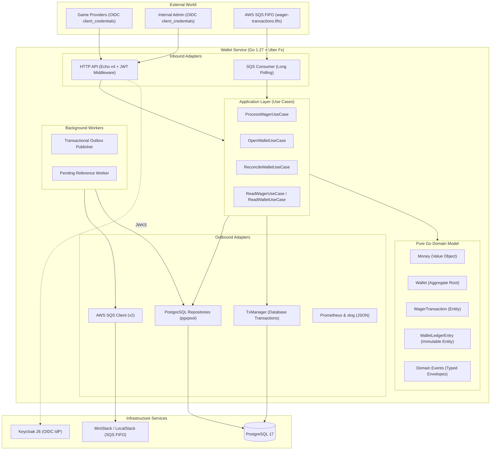
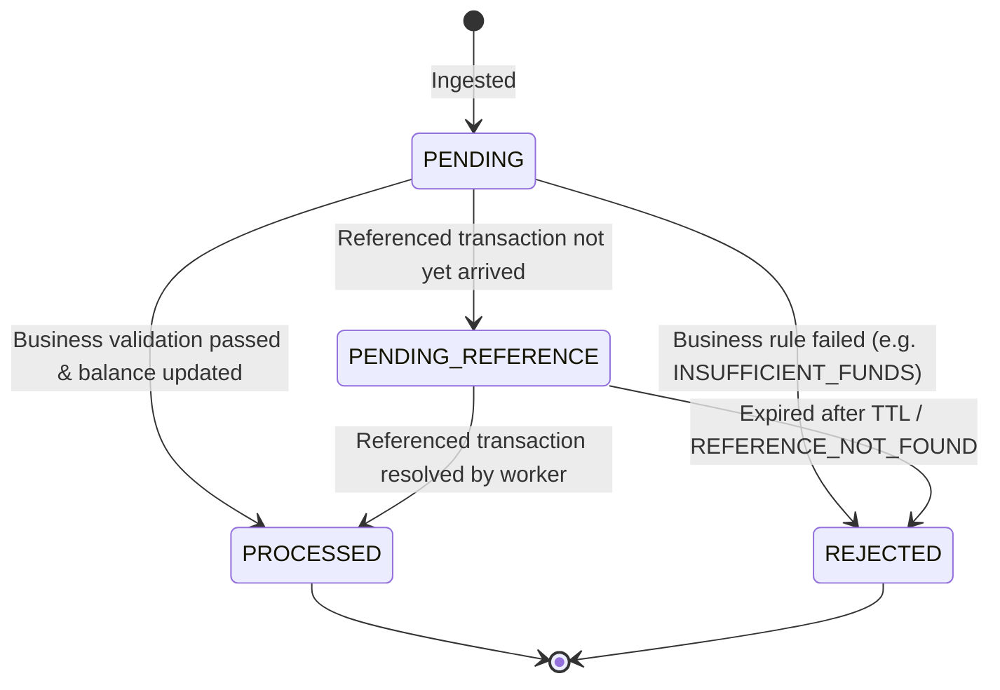

# Architecture and Technical Decisions

This document details the architectural decisions, design invariants, concurrency controls, and trade-offs implemented in the distributed wallet service.

---

## 1. Architectural Overview

The system implements Clean / Hexagonal Architecture with Domain-Driven Design (DDD) principles. It is composed as a single modular binary using **Uber Fx** for dependency injection and lifecycle management.



### Core Architecture Rules:
1. **Total Domain Isolation**: The `internal/domain` package is pure Go. It contains zero imports of Uber Fx, Echo, pgx, SQL, AWS SDK, or third-party web/database frameworks.
2. **Encapsulation & Factory Separation**: Aggregate roots and entities encapsulate internal state through private fields. Factory constructors (`New...`) enforce business creation invariants, while rehydration functions (`Rehydrate...`) restore persisted data from the database without re-executing business rules or re-emitting events.
3. **Stateless Scale-Out**: Instances maintain zero local or in-memory operational state. Any number of application instances can run simultaneously and coordinate safely through PostgreSQL and SQS FIFO.

---

## 2. Financial Integrity & Zero Floating-Point Arithmetic

Floating-point types (`float32`, `float64`) are strictly prohibited across the entire codebase.

### 2.1 Money Value Object (`internal/domain/money`)
- Monetary values are represented in minor units (`int64` centavos) alongside a 3-letter ISO 4217 currency code (e.g., `100.00 BRL` = `10000` minor units).
- Parsing strictly enforces the regex `^\d+\.\d{2}$`. Any input containing negative signs, scientific notation, `NaN`, `Inf`, missing decimals, or more than two decimal places is immediately rejected.
- Arithmetic operations (`Add`, `Sub`, `Neg`) explicitly check for integer overflow and underflow against `math.MaxInt64` and `math.MinInt64`.
- Explicit zero values (`money.Zero("BRL")`) prevent uninitialized state.
- Currencies are verified on every operation: cross-currency arithmetic returns `CURRENCY_MISMATCH`.

```go
type Money struct {
    amount   int64  // minor units (centavos)
    currency string // ISO 4217
}
```

---

## 3. Concurrency Control & Row-Level Serialization

### 3.1 Lock Strategy
- Global locks and table locks are strictly prohibited.
- High-concurrency wallet updates use pessimistic row-level locking:
  ```sql
  SELECT id, player_id, currency, balance_minor, version, created_at, updated_at
  FROM wallets
  WHERE id = $1
  FOR UPDATE;
  ```
- Because locks are held solely on the individual wallet row within the active database transaction, operations on distinct wallets proceed in parallel without contention.
- In addition to row locking, wallets track a monotonically increasing `version` column, incremented on every balance modification.

### 3.2 Idempotency Race Condition Prevention
To prevent unique constraint collisions during high-concurrency bursts of identical requests:
1. The wallet row is locked with `FOR UPDATE` **before** evaluating idempotency keys.
2. Concurrent duplicate requests for the same wallet are serialized at the database level.
3. The first request acquires the row lock, finds no prior transaction, executes the operation, creates the idempotency record, and commits.
4. The waiting duplicate request acquires the lock immediately thereafter, queries the idempotency table, detects the committed transaction, and returns the original result (`idempotentReplay: true`) without attempting a duplicate insert.

---

## 4. Persistent Idempotency & Conflict Detection

Idempotency guarantees that retried requests—whether caused by network timeouts, client retries, or SQS redeliveries—produce exactly one financial effect.

### 4.1 Persistence Model
Idempotency is persisted in PostgreSQL using unique indexes on `wager_transactions`:
- `ux_tx_idem`: `UNIQUE (provider_id, idempotency_key) WHERE origin = 'EXTERNAL'`
- `ux_tx_ext`: `UNIQUE (provider_id, external_transaction_id) WHERE origin = 'EXTERNAL'`

### 4.2 Canonical Business Payload Hashing
A SHA-256 hash is computed across normalized business fields:
```json
{
  "amount": "25.00",
  "currency": "BRL",
  "externalTransactionId": "tx-123",
  "gameId": "game-a",
  "kind": "BET",
  "playerId": "p-123",
  "providerId": "provider-a",
  "referenceExternalTransactionId": "ref-001",
  "roundId": "round-987",
  "walletId": "w-123"
}
```
- Transport metadata (HTTP headers, SQS message IDs, receipt handles) and the `Idempotency-Key` itself are strictly excluded from the hash calculation.
- Struct fields serialize in deterministic declared order, ensuring 100% hash equivalence between HTTP payloads and SQS message bodies.

### 4.3 Idempotency Replay vs Conflict
- **Identical Key + Identical Hash**: The original persisted transaction is returned with status code `200 OK` (or `202 Accepted` for pending references) and `idempotentReplay: true`. The returned `balance` reflects the exact balance recorded at the completion of that specific transaction.
- **Identical Key + Differing Hash**: Rejected with `409 Conflict` (`IDEMPOTENCY_CONFLICT`), incrementing `idempotency_conflicts_total`.

---

## 5. Immutable Append-Only Ledger

The ledger provides an auditable, append-only historical record of all financial balance changes.

### 5.1 Storage & Schema
```sql
CREATE TABLE wallet_ledger_entries (
    id UUID PRIMARY KEY,
    seq BIGSERIAL UNIQUE,
    wallet_id UUID NOT NULL REFERENCES wallets(id),
    transaction_id UUID NOT NULL REFERENCES wager_transactions(id),
    direction TEXT NOT NULL CHECK (direction IN ('DEBIT', 'CREDIT')),
    amount_minor BIGINT NOT NULL CHECK (amount_minor > 0),
    currency CHAR(3) NOT NULL,
    balance_before_minor BIGINT NOT NULL CHECK (balance_before_minor >= 0),
    balance_after_minor BIGINT NOT NULL CHECK (balance_after_minor >= 0),
    created_at TIMESTAMPTZ NOT NULL,
    UNIQUE (wallet_id, transaction_id),
    CHECK (
        (direction = 'CREDIT' AND balance_after_minor = balance_before_minor + amount_minor) OR
        (direction = 'DEBIT'  AND balance_after_minor = balance_before_minor - amount_minor)
    )
);
```

### 5.2 Immutability Guarantees
- A PostgreSQL database trigger `prevent_ledger_update_or_delete` intercepts and blocks any `UPDATE`, `DELETE`, or `TRUNCATE` operations on `wallet_ledger_entries`.
- Production database roles have `UPDATE` and `DELETE` privileges explicitly revoked.
- Transactions that do not alter balances (`LOSS` and `REJECTED` wagers) produce zero ledger entries and leave the wallet version unchanged.

### 5.3 Deterministic Pagination
Ledger entries expose sequential ID ordering (`seq BIGSERIAL`). The `GET /wallets/:walletId/ledger` endpoint uses opaque base64-encoded cursor tokens (`{"seq": 1234}`) to guarantee deterministic, drift-free pagination.

---

## 6. Wager State Machine & Reversal Policies

Transactions follow a strict state machine with terminal states:



### 6.1 Transaction Types
| Kind | Effect on Balance | Conditions |
| --- | --- | --- |
| `BET` | Debit | Amount > 0, balance >= amount |
| `WIN` | Credit | Amount > 0 |
| `LOSS` | None | Amount must be strictly 0.00; status `PROCESSED`, no ledger entry |
| `REFUND` | Credit | Reverses a prior `BET`; amount, currency, round, and player must match |
| `ROLLBACK` | Inverse | Reverses a `BET` (credit), `WIN` (debit), or `REFUND` (debit) |

### 6.2 Single-Slot Reversal Policy
To prevent double-reversals, a referenced transaction has exactly one successful reversal slot, enforced by a partial unique database index:
```sql
CREATE UNIQUE INDEX ux_tx_one_reversal 
ON wager_transactions (reference_transaction_id) 
WHERE kind IN ('REFUND', 'ROLLBACK') AND status = 'PROCESSED';
```
- A second reversal attempt on the same referenced transaction is rejected with `ALREADY_REVERSED`.
- If a reversal requires a debit (e.g. rolling back a `WIN`) and the wallet lacks sufficient balance, it is rejected with `REVERSAL_INSUFFICIENT_FUNDS`.

---

## 7. Pending Reference Handling

When an external provider sends a `REFUND` or `ROLLBACK` before the original `BET` arrives (due to network reordering or asynchronous broker dispatch):
1. The transaction is accepted with HTTP status `202 Accepted` and status `PENDING_REFERENCE`.
2. An initial retry deadline (`next_attempt_at = now + 1s`) and expiration (`expires_at = now + 30m`) are assigned.
3. A domain event `WagerTransactionPendingReference` is stored in the outbox.
4. When the referenced `BET` is subsequently processed, the application triggers a wake-up update (`next_attempt_at = now()`) on any waiting pending references.
5. A background worker periodically claims pending references using `SELECT ... FOR UPDATE SKIP LOCKED`, resolves them against the referenced transaction, and commits the state transition.
6. If a reference remains unresolved after 30 minutes, it transitions to `REJECTED` with failure code `REFERENCE_NOT_FOUND`.

---

## 8. Messaging: Transactional Outbox & Inbox

### 8.1 Transactional Outbox
Domain events are written to `outbox_events` within the exact same database transaction as the financial mutations. No event is ever dispatched to the broker before the local SQL transaction commits.

- **Publisher Worker**: Runs periodically across application instances.
- **Distributed Lease**:
  ```sql
  UPDATE outbox_events
  SET locked_by = $1, locked_until = $2, attempts = attempts + 1
  WHERE id IN (
      SELECT id FROM outbox_events
      WHERE published_at IS NULL AND next_attempt_at <= NOW() AND (locked_until IS NULL OR locked_until < NOW())
      ORDER BY occurred_at ASC
      LIMIT 50
      FOR UPDATE SKIP LOCKED
  )
  RETURNING id, aggregate_id, event_type, payload;
  ```
- **SQS FIFO Dispatch**: Events are published with `MessageGroupId = walletId` and `MessageDeduplicationId = eventId`.
- **Fault Recovery**: If an instance crashes while publishing, the lease (`locked_until`) expires after 30 seconds, allowing another instance to claim and publish the pending event without data loss.

### 8.2 SQS Consumer & Inbox Deduplication
- SQS consumer polls messages via long polling (`WaitTimeSeconds = 20`).
- **Inbox Deduplication**: Before executing use case logic, the consumer executes:
  ```sql
  INSERT INTO inbox_messages (consumer_name, message_id, payload_hash, received_at)
  VALUES ($1, $2, $3, $4)
  ON CONFLICT (consumer_name, message_id) DO NOTHING;
  ```
- If the message was already processed and matches the recorded payload hash, it is acknowledged and removed from SQS without re-executing.
- If the message payload hash conflicts with a previously recorded message ID, it is flagged as corrupted and routed to the Dead Letter Queue (DLQ).
- Unhandled processing errors leave the message in the queue; after 5 retries (`maxReceiveCount = 5`), SQS redrives the message to `wager-transactions-dlq.fifo`.

---

## 9. Authentication & Multi-Tenant Authorization

Security is enforced at the HTTP adapter layer using OAuth2 / OIDC client credentials against Keycloak.

### 9.1 Verification & Scopes
- Tokens are verified cryptographically via Keycloak's JWKS endpoint (`JWKS_URL`), with in-memory key caching and periodic refresh.
- The token payload is parsed to extract the authenticated client identity:
  - `client_id`
  - `realm_access.roles`
- Public routes (`/health/live`, `/health/ready`, `/metrics`) bypass authentication.

### 9.2 Authorization Matrix
| Route | External Provider Client | Internal Admin Client | Public / Unauthenticated |
| --- | --- | --- | --- |
| `POST /wagering/transactions` | Allowed (only if `req.providerId == token.client_id`) | Allowed (internal admin) | 401 Unauthorized |
| `GET /wagering/transactions/:id` | Allowed (only if transaction belongs to caller) | Allowed | 401 Unauthorized |
| `GET /providers/:pid/.../:extId` | Allowed (only if `pid == token.client_id`) | Allowed | 401 Unauthorized |
| `POST /wallets` | 403 Forbidden | Allowed | 401 Unauthorized |
| `GET /wallets/:id` | 403 Forbidden | Allowed | 401 Unauthorized |
| `GET /wallets/:id/ledger` | 403 Forbidden | Allowed | 401 Unauthorized |
| `POST /wallets/:id/reconciliation` | 403 Forbidden | Allowed | 401 Unauthorized |
| `/health/live`, `/health/ready`, `/metrics` | Allowed | Allowed | 200 OK |

---

## 10. Automated End-to-End Reconciliation

Reconciliation continuously proves that the wallet's stored balance matches the ledger history.

### 10.1 Mathematical Proof
$$\text{StoredBalance} = \sum \text{Credits} - \sum \text{Debits}$$

The reconciliation use case (`ReconcileWalletUseCase`) executes within an atomic database query:
```sql
SELECT 
    COUNT(*),
    COALESCE(SUM(CASE WHEN direction = 'CREDIT' THEN amount_minor ELSE 0 END), 0),
    COALESCE(SUM(CASE WHEN direction = 'DEBIT' THEN amount_minor ELSE 0 END), 0)
FROM wallet_ledger_entries
WHERE wallet_id = $1;
```

It validates:
- `Difference = StoredBalance - CalculatedBalance`
- `Consistent = (Difference == 0.00)`
- If an inconsistency is detected, `observability.Metrics.ReconciliationMismatch.Inc()` is triggered.

---

## 11. Observability & Graceful Shutdown

### 11.1 Metrics
Prometheus metrics are served at `/metrics`:
- `wallet_transactions_total{kind, status}`: Total transactions processed by kind and status.
- `wallet_idempotency_conflicts_total`: Number of 409 Conflict errors.
- `wallet_idempotency_replays_total`: Number of idempotency replay requests served.
- `wallet_outbox_published_total{event_type}`: Total events dispatched to SQS.
- `wallet_outbox_lag_seconds`: Elapsed time for uncommitted outbox items.
- `wallet_reconciliation_mismatches_total`: Count of financial reconciliation inconsistencies.
- `wallet_sqs_messages_total{status}`: Total SQS messages received and outcome.
- `wallet_dlq_messages_total`: Count of messages redriven to DLQ.

### 11.2 Graceful Shutdown
Upon receiving `SIGTERM` or `SIGINT`:
1. Echo HTTP server stops accepting new connections and drains in-flight requests (up to `HTTP_SHUTDOWN_TIMEOUT = 20s`).
2. SQS consumer terminates long-polling loops and awaits in-flight message processing completion.
3. Outbox and pending reference workers release held leases and complete active batches.
4. Database connection pool drains and closes cleanly.

---

## 12. Trade-offs, Limitations & Future Work

1. **Currency Support**: The domain model is designed for multi-currency operations via ISO 4217 validation, but production configurations are tailored for `BRL`. Future work includes cross-currency FX conversion tables.
2. **Ledger Table Partitioning**: In extreme high-throughput production environments with hundreds of millions of ledger entries, `wallet_ledger_entries` should be partitioned by range (`created_at`) or hash (`wallet_id`).
3. **Local Broker Emulation**: MiniStack 1.5.24 is utilized for SQS FIFO emulation in local development and testing. While it supports standard FIFO and redrive behavior, production deployments should utilize AWS IAM role-based authentication rather than static test credentials.
